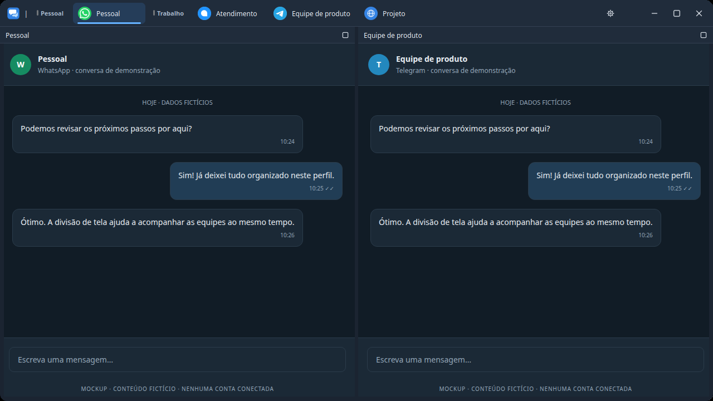
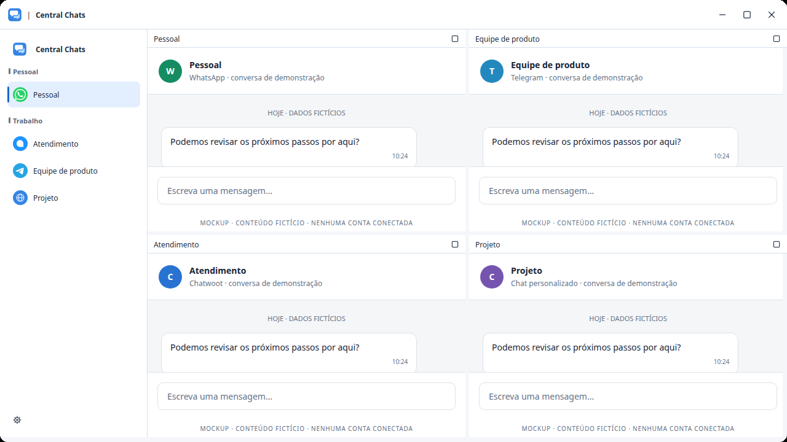
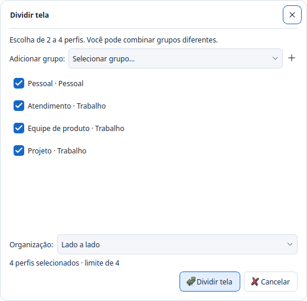

# Central Chats

**Seus perfis de conversa em uma janela. Agora, lado a lado também.**

Central Chats é um aplicativo comunitário para Linux que reúne WhatsApp Web,
Telegram, Chatwoot e chats com endereço personalizado. Cada perfil tem sua própria
sessão. A interface é feita em Python/Qt e o conteúdo web usa CEF, sem Electron.

**Desenvolvido com apoio de IA (OpenAI Codex), sob direção, testes de uso e
responsabilidade de [Matheus Feitosa](https://github.com/MatheusHSFeitosa).**
Veja os [créditos e referências](CREDITS.md).



> As imagens são mockups capturados da interface do aplicativo, com conversas
> fictícias. Não mostram contas, contatos ou mensagens reais. A aparência interna
> dos serviços depende de cada site e de seu tema.

## O que você pode fazer

- Manter vários perfis com sessões independentes na mesma janela.
- Criar grupos personalizados ou organizar os perfis por serviço.
- Dividir a tela entre **2 a 4 perfis**, de um mesmo grupo ou de grupos diferentes.
- Usar colunas, linhas ou uma grade 2 × 2; ajustar a divisão dos dois painéis.
- Alternar entre tema claro, escuro e preferência do sistema.
- Posicionar as abas à esquerda, acima ou abaixo; recolher a barra lateral.
- Redimensionar a janela por qualquer borda ou canto.
- Arrastar pelas áreas vazias da interface ou usar **Alt + arrastar** sobre o chat,
  preservando os cliques em links, mensagens, botões e campos de texto.
- Usar ícones do serviço, ícones predefinidos ou uma foto escolhida no computador.
- Abrir links no navegador e selecionar arquivos em diálogos da Central.
- Receber notificações enquanto os perfis estiverem carregados, inclusive em
  segundo plano quando o ambiente permitir reabrir a Central.
- Fazer chamadas nos serviços web que as oferecerem, com autorização de câmera
  e microfone. A disponibilidade depende do serviço e da conta.



## Instalar

A prévia **0.13.0** oferece pacote DEB amd64 para Pop!_OS/Ubuntu 22.04 e 24.04.
Encerre a Central por **Configurações → Sair da central** antes de atualizar.

```sh
mkdir -p ~/Downloads/central-chats
cd ~/Downloads/central-chats
curl -fLO https://github.com/MatheusHSFeitosa/central-whatsapp/releases/download/v0.13.0/central-whatsapp_0.13.0_amd64.deb
curl -fLO https://github.com/MatheusHSFeitosa/central-whatsapp/releases/download/v0.13.0/SHA256SUMS
sha256sum -c SHA256SUMS
sudo apt install ./central-whatsapp_0.13.0_amd64.deb
```

O APT instala um **arquivo local**. Ainda não existe repositório APT assinado para
atualizações automáticas. Veja também a página de
[Releases](https://github.com/MatheusHSFeitosa/central-whatsapp/releases).

Para remover o pacote: `sudo apt remove central-whatsapp`. Os dados do usuário
ficam preservados; remover o aplicativo não desconecta os dispositivos no celular.

### Instalação no usuário a partir do código

Requer Python 3.10–3.12, o pacote `python3-venv`, compilador C++20, `pkg-config`,
`libglib2.0-dev` e as bibliotecas gráficas descritas em
[compatibilidade](docs/COMPATIBILITY.md).

```sh
git clone https://github.com/MatheusHSFeitosa/central-whatsapp.git
cd central-whatsapp
sh scripts/install-user.sh
```

O instalador cria um ambiente Python separado, prepara o CEF fixado por SHA-256
e adiciona o ícone ao menu. O download do SDK CEF é grande. Para remover essa
instalação: `sh scripts/uninstall-user.sh`.

## Criar perfis e dividir a tela

1. Abra **Configurações → Adicionar perfil** e escolha o serviço.
2. Informe nome, grupo e imagem. Para Chatwoot ou outro chat, informe o endereço
   HTTPS do seu servidor. Faça login na própria página do serviço.
3. Abra **Configurações → Dividir tela** (`Ctrl+\`). Marque de 2 a 4 perfis.
4. Use **Adicionar grupo** para marcar seus integrantes; combine com outros
   perfis se desejar. Escolha colunas, linhas ou grade.
5. Para sair, use **Voltar a um perfil** ou o botão no cabeçalho de um painel.

Selecionar uma aba que já está na divisão mantém os painéis. Selecionar um perfil
fora dela retorna à visualização individual. Os painéis reutilizam as sessões;
voltar a uma aba não desconecta os demais perfis.



## Sistemas testados e limites

| Ambiente | Situação |
| --- | --- |
| Pop!_OS 24.04 / COSMIC / XWayland / amd64 | Uso local e testes nativos de janela, abas, divisão, mouse e teclado |
| Pop!_OS 22.04 / GNOME / X11 / amd64 | Base de uso das versões anteriores; motor CEF e chamadas reais do WhatsApp validados pelo autor |
| Ubuntu 22.04 e 24.04 / X11 / amd64 | Alvos de verificação automatizada no GitHub Actions |
| Outras distribuições Linux com X11/XWayland | Possível instalação por código; ainda sem validação específica |
| Wayland nativo | A interface e o CEF usam **XWayland/X11**; modo nativo não suportado |
| Flatpak / Flathub | Ainda não validado com CEF; não publicado |
| Windows, macOS e ARM | Sem pacotes e sem validação |

A divisão de tela aumenta o número de perfis ativos. Não há promessa de consumir
menos RAM/CPU do que um navegador. Veja a
[matriz detalhada e os testes](docs/COMPATIBILITY.md).

## Sessões, notificações e privacidade

- Perfis e preferências ficam em `~/.local/share/central-whatsapp-data`.
- Cada perfil usa uma pasta CEF própria. O antigo armazenamento Qt, quando
  presente, é copiado uma vez e preservado. Trocas de motor podem exigir login.
- A Central não tem servidor próprio nem coleta própria de telemetria. Cada
  serviço web mantém suas próprias políticas de dados.
- A bolinha na aba sinaliza notificações recebidas nesta execução; não é um
  contador independente de mensagens não lidas.
- Notificações criadas pela página passam pela Central e preservam seu
  manipulador de clique. Avisos exclusivos de service workers dependem do suporte
  Chromium/sistema; seu roteamento personalizado ainda não está validado.
- Câmera/microfone são autorizados por perfil e origem. Captura de tela não é
  concedida por este host.
- Fechar pelo X pode manter a Central em segundo plano, conforme a preferência.
  Para encerrar completamente, use **Sair da central**.

## Desenvolvimento e testes

```sh
python3 -m venv .venv
.venv/bin/python -m pip install -r requirements-dev.txt
.venv/bin/python -m unittest discover -s tests -p 'test_*.py' -v
python3 scripts/prepare-cef.py
export CENTRAL_CEF_RUNTIME="$PWD/build/cef-runtime"
export QT_QPA_PLATFORM=xcb
.venv/bin/python tests/cef_native_events_smoke.py
.venv/bin/python tests/cef_window_smoke.py
.venv/bin/python tests/cef_split_smoke.py
.venv/bin/python tests/cef_smoke.py
```

Os testes CEF usam servidor local, perfis temporários e dispositivos simulados;
não acessam contas reais. O conjunto antigo de regressão da interface é executado
com `CENTRAL_BROWSER_ENGINE=qt-test`. O funcionamento normal usa CEF.

Código sob [MIT](LICENSE). Bibliotecas e marcas mantêm suas próprias licenças.
O aplicativo não é afiliado a WhatsApp/Meta, Telegram, Chatwoot, GNOME ou Qt.
