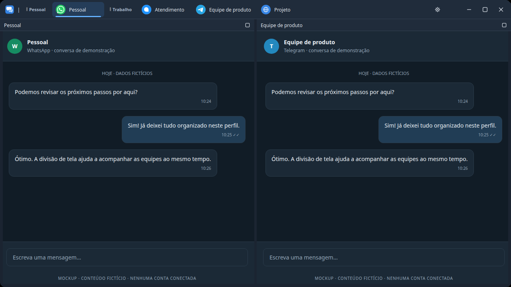
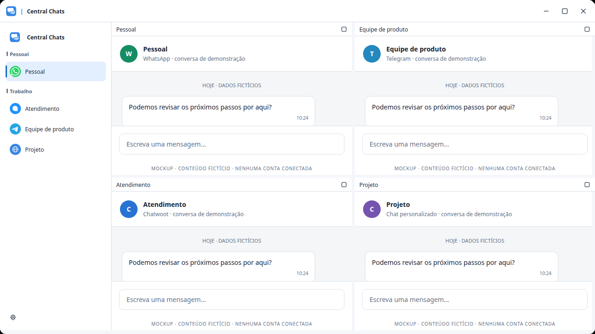
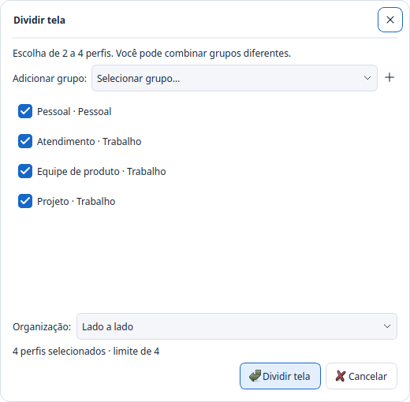

# Central Chats 0.13.0 — conversas na mesma janela, agora lado a lado

O projeto agora tem uma prévia pública. Central Chats reúne múltiplos perfis de
WhatsApp Web, Telegram, Chatwoot e chats com endereço personalizado em uma janela
Linux, com sessões independentes e sem Electron.

**Este aplicativo foi desenvolvido com apoio de inteligência artificial (OpenAI
Codex), sob direção, revisão e testes de uso de Matheus Feitosa.**

## Novidades

- Divisão entre **2 a 4 perfis**, escolhendo um grupo ou combinando perfis de grupos
  distintos, em colunas, linhas ou grade.
- Retorno à aba individual sem recriar as sessões; ajuste da largura entre dois
  painéis e restauração da divisão depois de sair de tela cheia.
- Redimensionamento por todas as bordas e cantos.
- Arraste pelas áreas vazias e **Alt + arrastar** no conteúdo dos chats, preservando
  os cliques normais em mensagens, links e botões.
- Temas claro/escuro/sistema, abas na lateral/acima/abaixo e grupos personalizados.
- Chatwoot com o endereço HTTPS escolhido pelo usuário.
- CEF incorporado à janela Qt em X11/XWayland, incluindo COSMIC no Pop!_OS 24.04.

**Imagens de demonstração:** mockups capturados da interface real da Central com
páginas e conversas fictícias. Não são contas, mensagens ou contatos reais; a
aparência interna de cada serviço pode ser diferente.

## Instalação e compatibilidade

O pacote DEB amd64 destina-se a Pop!_OS/Ubuntu **22.04 e 24.04**, com Python
3.10–3.12. Baixe o DEB e o arquivo SHA256SUMS desta versão e siga o
[passo a passo de instalação](https://github.com/MatheusHSFeitosa/central-whatsapp#instalar).
Encerre a versão anterior por **Configurações → Sair da central** antes de atualizar.

A interface e o motor usam **X11/XWayland**. Wayland nativo, Flatpak/Flathub,
Windows, macOS e ARM ainda não estão validados. O APT instala o arquivo local;
não há repositório APT assinado para atualizações automáticas.

O uso local foi realizado em Pop!_OS 22.04/GNOME e 24.04/COSMIC. A matriz de testes
Ubuntu 22.04/24.04 verifica interface, armazenamento, eventos nativos, mídia e
conexões WebRTC fictícias; não faz login ou ligações para contatos reais.
O autor confirmou chamadas reais de entrada/saída com áudio e vídeo no laboratório
WhatsApp do mesmo motor CEF. Outros serviços dependem de sua própria oferta web.

## Referências, autoria e créditos

- **Matheus Feitosa:** ideia, direção, escolhas visuais e validação de uso.
- **OpenAI Codex:** apoio de IA na implementação, investigação, testes, documentação
  e mockups.
- **GNOME HIG:** referência visual de uma interface Linux simples e compacta.
- **Qt/PySide6:** interface e diálogos; **CEF/Chromium:** conteúdo web.
- **tobagin/Karere:** distribuição do binário CEF com codecs, fixada por SHA-256.
  A interface e o código de aplicação Karere não foram copiados.
- **GLib/X11/XWayland**, **dbus-next** e **nlohmann/json:** eventos, notificações e IPC.

Links, licenças e referências completas em
[Créditos](https://github.com/MatheusHSFeitosa/central-whatsapp/blob/main/CREDITS.md) e
[Compatibilidade](https://github.com/MatheusHSFeitosa/central-whatsapp/blob/main/docs/COMPATIBILITY.md).

Código MIT; componentes e marcas mantêm suas próprias licenças. Aplicativo
comunitário, sem afiliação aos serviços integrados. Esta é uma **prévia**, não uma
promessa de compatibilidade com qualquer conta, servidor ou distribuição Linux.
